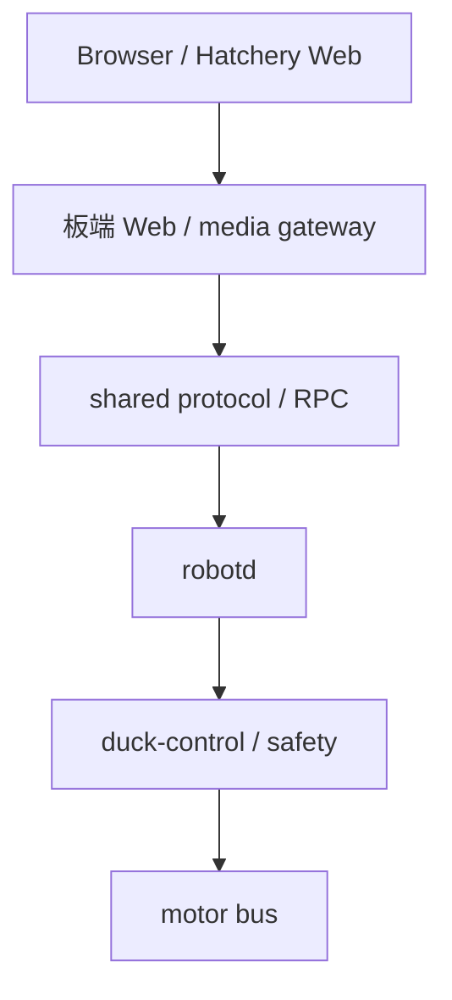

# Microduck Hatchery 当前结构与架构边界

主要依据是用户提供的 [microduck-hatchery-architecture-v2.md](microduck-hatchery-architecture-v2.md)。本文件解释当前落地状态，发生冲突按最新用户决定和 v2 处理。设备模块位于 `src/daemons` 和 `src/libraries`，保留完整 crate 边界。

当前范围：在既有摄像头与 FT 舵机基础上，按用户授权升级非舵机官方源码并补齐剩余 crate；FT 驱动和控制逻辑保留原版。版本、保留范围与核对结果见 [迁移基线](MIGRATION_BASELINE.md)，逐阶段状态见 [执行计划](OFFICIAL_MIGRATION_EXECUTION.md)。Radxa 部署、实机测试和动作验收由用户执行；源码到位不表示硬件能力已验证。详细范围见 [RADXA_RUNTIME.md](RADXA_RUNTIME.md)。

Web 的只读 3D 使用本地 Three.js 与带许可的参考模型，不改变设备权威、crate 边界或生产栈。正式 robot.* 只读订阅通过共享缓存供总控、关节反馈、曲线与 3D 使用；以官方关节名称映射后端 rad，独立于本地 ticks 草稿和总线 ID。未标定的 FT 后端不发布有效角度时保持缺测。设备输入观察使用官方 padd 的只读 tap，相机视觉工具在浏览器处理既有视频，不增加采集器。静态入口保留样例；实际装机标定仍由后端裁决，见 [联调说明](../web/docs/JOINT_COORDINATION.md)。

## 目录

```text
microduck-hatchery/
├─ src/
│  ├─ daemons/
│  │  └─ robotd/、updater/、configd/、btd/、padd/、mediad/、tof/、netpadd/、nfc/
│  └─ libraries/
│     └─ duck-control/、robotd-params/、kinematics/、odometry/、
│        sounds/、pet-detect/、duck-detect/、pad-imu/、pad-map/、uyvy/
├─ protocol/
│  ├─ duck-ipc-proto/、duck-ble/
│  └─ mappings/、fixtures/、schemas/（既有样例 JSON）
├─ tools/
│  ├─ robotctl/、duckctl/、xtask/、test-support/、duck-ether/
│  ├─ hatchery-shell/
│  └─ check_shell.py
├─ web/              Hatchery 前端与设计包
├─ hardware/         实际硬件资料
├─ training/         保留所选训练源码内部结构的位置
├─ deploy/           Radxa 配置与部署说明
├─ hooks/            安装钩子位置
├─ scripts/          样例 / 维护启动、Radxa 构建和媒体依赖入口
├─ spaces/           hello/、policy-playground/、shared/、vision-demo/、vetbook/
├─ docs/
└─ logs/
```

目录位置保持 v2。workspace 当前 26 成员，完整 crate 保留内部结构。新增 updater、btd、padd、tof、netpadd、nfc、pad-imu、pad-map、duck-ble、robotctl、duckctl、duck-ether、xtask；默认仍仅构建 robotd / mediad。Spaces 与 hooks 源码已迁入，training 已按独立来源冻结并迁入两个原始仓库；源码存在不代表已部署或 Web 功能接通。

分类不拆 crate、不改 crate 名，不创建 drivers / runtime / robot_io 框架。官方 obs / policy / safety 已迁入；FT bus_select / bus_feetech 复用现有分支，原生 FT 包实现复用 kissqy 的 Apache-2.0 固件部分。硬件差异留在 bus / io，上层不用 FT 寄存器。

## Radxa 整机与电脑维护

维护入口保留单 ID 原值台架命令。robotd 的 maintenance_main / maintenance 验证会话、期限、去重和限幅，collector 独占串行执行；bus 仅开放 FD HLS 参考 SRAM 子集，gateway 仅转发，Web 仅管理草稿。未归类 ID 不成为策略或关节条目。完整 FD、装机校准、实际动作和板端运行仍待实现 / 验收。

**Radxa Zero 3W 是主要运行平台。** Windows 的 FD1985 通过 FE-URT2 调试舵机；Hatchery 的 Windows / macOS 本地维护入口是辅助能力。装机后由电脑浏览器访问 Radxa gateway，权威仍在板端 robotd / duck-control。台架时使用本机最小维护服务，不启动整机策略、IMU、Camera 或其他 daemon。

官方板端 binary 为 robotd / mediad，显式启用 board-runtime；电脑 binary 为 robotd-maintenance / mediad-maintenance。FT 整机默认只读，策略 / 输出 / 增益 / 自动 ID 替换禁用；校准缺失时不发布伪造角度。维护与整机服务互斥，FD 等外部软件同样必须关闭串口。既有 Windows ID 1 PING 不替代 HD 寄存器、整机运控或 Radxa 验收；见 [维护后端](MAINTENANCE_BACKEND.md) 和 [Radxa 指南](RADXA_RUNTIME.md)。

## 正式控制关系

控制边界如下；Hatchery 总控已接正式 robot.* 只读观察，动作与关节映射整合仍待完成，维护入口保持独立协议：



web/ 只负责页面、目标草稿、展示缓存和只读回放。板端 gateway 位于 mediad；官方 webclient 已保留在 crate 内，显式 `/reference` 提供参考入口，不替代 Hatchery UI。媒体根页面是本项目的浅色只读相机预览。协议库不依赖前端、硬件寄存器或 RL。 网络操作由同源维护 gateway 转发官方 configd 的 Unix RPC，NetworkManager / BlueZ 持有系统配置；见 [设备连接](DEVICE_CONNECTIONS.md)。传感器视频复用官方 WebRTC。相机参数由同源维护 gateway 转发本机媒体 RPC，mediad 独占 V4L2 / RKAIQ 写入并仲裁自动 / 手动曝光；前端不直接调用驱动，采集帧率、分辨率与模式仍只读。见 [相机实时参数](CAMERA_CONTROLS.md)。

`robotd` 与 `duck-control` 保留官方的上层职责：生命周期、模式、状态、执行、控制循环和安全裁决。前端或 gateway 不能成为第二个权威控制器，不能直接写总线。命令接收、应用/读回和物理到位分别定义，逐关节结果由设备端产生。

## 当前可运行样例

Python 只读样例位于 [tools/hatchery-shell/](../tools/hatchery-shell/README.md)，不属于生产设备模块。仓库根 `src/` 按 daemons 与 libraries 分类。

启动入口是 `python scripts/hatchery-shell.py --port 8080`。工具读取根 `protocol/` 的样例 JSON，同源提供 `web/prototype/` 和未完成的 `web/shell/`。它只监听 loopback，明确返回 sample/fake/read-only 标记，不连接硬件、不执行目标，也不是正式 gateway 或 robotd 的实现。

`web/shell/app.js` 尚缺；完整检查无法通过。`--transport-only` 只核验样例服务和资源路径，不验证诊断页交互。现有 schema 与实际样例消息也有字段不一致，且依赖清单尚未列出检查/WS 所用 `websockets`；均保留为已知缺口，本轮不扩展功能或修改协议 JSON。

## 实际硬件边界

- 平台以 Radxa Zero 3W、FT / Feetech 和实际固件配置为准，不默认完整 Robot HAT 或官方设备节点。
- 后续移动或适配硬件代码前，先核对现有 FT 代码与冻结版本；优先复用 `bus.rs` / `io.rs` 等边界，不另造驱动框架，不让寄存器和串口细节进入 policy、observation 或 Web。
- UART、I2C、GPIO、Camera、IMU、ToF 的节点、权限和可用性由实物与配置确定。当前样例不证明任何设备可访问。
- 总线只能由当前活动控制后端占用；robotd 运行时，校准后端及其串口轮询都必须停止。读取同样需要仲裁，不能依靠进程内锁管理两个进程。
- FT 位置保留 ticks、负载保留 raw load；角度转换要求核对过的校准方向、零位和单位。Unix 与单调时间分开；真实/fake/sim 和 IMU 来源明确表达。
- `release` 不是停止或急停。失联、期限、取消和重连规则由设备端实现；回放不发送历史目标。

15 个物理关节包含 mouth #34；IMU 不计作关节，不默认采用官方 ID 200 或 kissqy FT6。显示左腿 → 右腿 → 头颈嘴，运行时左腿 → 头颈嘴 → 右腿，14 维策略去掉嘴部；样例映射不是实物校准结果。

## 构建与路径

src/Cargo.toml / Cargo.lock / rust-toolchain.toml 管理 26 个成员，锁定官方依赖基线与维护所需的小量补充。daemon / library 分类后修正 path dependency；顶层 IPC 和 test-support 显式指向 ../../src。默认输出 src/target/，维护启动器区分 debug / release 和维护 binary；板端脚本显式构建 board-runtime。参数配置与资源 include 路径同步调整，未导入的模块不生成空 manifest。

尚未分配关节的台架 ID（如 ID 1）只进入维护协议的 `unassigned_devices`，没有 runtime / policy 索引；15 个物理关节的映射不会由串口枚举或 PING 改写。只读维护允许显式指定最多 32 个独立总线 ID，拒绝重复和广播 ID，不进行自动扫描。

本轮 systemd 单元保留在 daemon crate 内，通过统一 Radxa 配置启动；维护单元位于 deploy/radxa。官方 xtask、CI、OTA hooks 和 provision 已作为源码迁入，尚未安装或验收。仍须核对查根、发布和测试资源路径；分类路径不等于安装路径。

运行部署需区分源码、发布文件、设备配置/校准、可变状态与临时 socket；具体路径和权限按 Radxa 镜像核对。`logs/` 保存开发记录及日志规则，不替代板端日志系统。

仿真、RL、标准策略导出、FT 运行时和实机验证仍属于必需全栈主线。`training/` 保留 RL 与检测训练上游内部结构，浏览器不执行训练或策略推理。七章仍按 [共同审查方案](../web/docs/LOCAL_REVIEW_PROPOSAL.md) 推进；[联调](../web/docs/JOINT_COORDINATION.md) 已实现为本地样例，不能替代正式协议、校准或控制。WiFi、USB-C gadget 网络和 BLE 桥均需独立验收，BLE 不默认用于高频运动控制。

实施顺序见 [PLAN.md](PLAN.md)，来源见 [SOURCES.md](SOURCES.md)，实际验证见 [LOCAL_STATUS.md](../web/docs/LOCAL_STATUS.md)。
